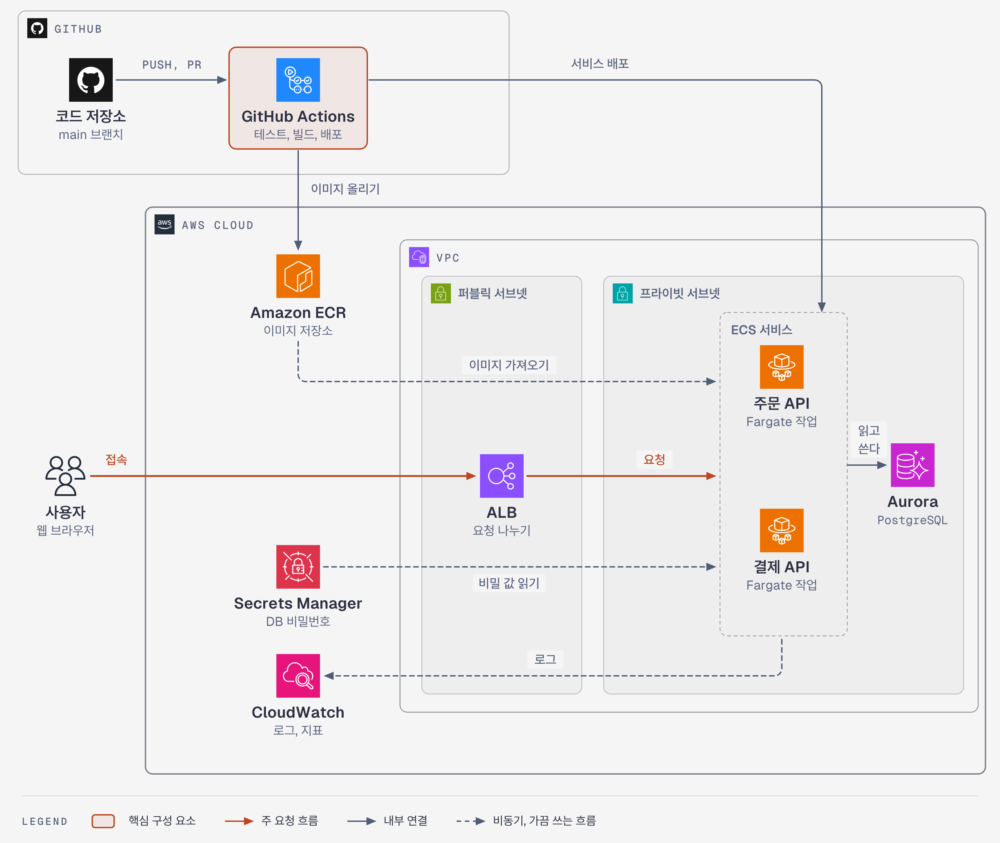
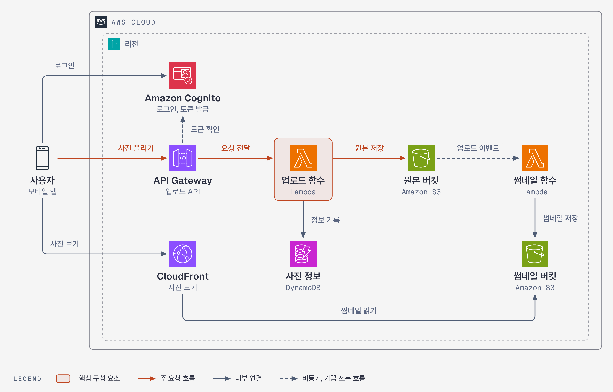
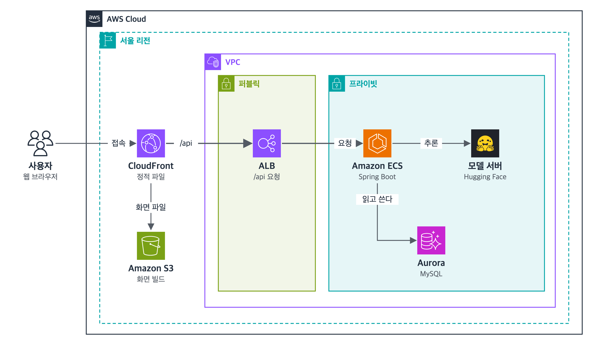

<div align="center">

# aws-style-diagram

[](#npx로-설치)
[](#npx로-설치)
[](#준비물)
[](assets/NOTICE.md)

AWS 공식 아이콘 스타일로 아키텍처 그림을 그리는 에이전트 스킬입니다.<br>
JSON 하나로 그림을 정의하면 문서에 바로 넣을 수 있는 PNG가 나옵니다. 선이 겹치거나 글자를 가리는 곳은 자동으로 찾아 줍니다.



</div>

시스템 구성도나 배포 구성도를 그릴 때마다 아이콘을 찾고 상자를 맞추고, 선이 글자를 가리지 않는지 눈으로 확인하는 일은 손이 많이 갑니다. 이 스킬을 쓰면 에이전트가 구성 요소와 연결만 JSON으로 적고, 그림은 스크립트가 그립니다. 그린 뒤에는 배치를 검사해서 문제를 목록으로 알려 줍니다. 에이전트는 그 목록을 보고 좌표를 고쳐 가며 그림을 완성합니다.

## 기능

- **AWS 공식 아이콘 그대로**: 서비스 아이콘 305개, AWS Cloud, Region, VPC, 서브넷 같은 그룹 상자, 사용자, 모바일, 건물 같은 일반 아이콘을 담았습니다. `eks`, `rds`, `alb`처럼 짧은 이름으로 부릅니다.
- **AWS 밖 기술도 같은 모양으로**: React, FastAPI, GitHub Actions, Argo CD, 쿠버네티스, Stripe 같은 로고를 브랜드색 정사각형 타일로 바꿔 AWS 아이콘 옆에 놓아도 어색하지 않게 맞춥니다.
- **배치 검사**: 선이 아이콘이나 글자를 지나가는지, 라벨이 다른 선이나 그룹 테두리에 걸치는지, 노드가 그룹 경계에 걸치는지, 사선이 섞였는지를 찾아 알려 줍니다.
- **문서용 크기**: 폭 1100px 캔버스를 3배로 찍습니다. A4 본문 폭에 넣어도 글자가 9~10pt로 읽힙니다.
- **Claude Code와 Codex에서 함께**: 저장소 하나를 두 도구의 스킬 폴더에 링크로 연결합니다. `git pull` 한 번으로 둘 다 갱신됩니다.

## 시작하기

### 준비물

- Python 3.9 이상 (표준 라이브러리만 씁니다)
- Google Chrome 또는 Chromium. PNG를 찍을 때 씁니다. 다른 위치에 있으면 `CHROME_PATH`로 경로를 알려 주세요.

### npx로 설치

clone 없이 설치하고, 갱신과 삭제도 `npx skills`로 합니다. Node.js가 필요합니다.

```bash
npx skills add kgyujin/aws-style-diagram-skill -g -a claude-code -a codex   # 설치
npx skills update -g aws-style-diagram                                      # 갱신
npx skills remove -g aws-style-diagram                                      # 삭제
```

`-g`는 모든 프로젝트에서 쓰도록 사용자 폴더에 설치하고, `-a`는 설치할 도구를 고릅니다. `-a`를 빼면 설치할 때 물어봅니다. 같은 컴퓨터에서 아래 clone 설치와 함께 쓰지 마세요. 두 방식이 같은 스킬 폴더를 씁니다.

### clone으로 설치

스킬을 직접 고치면서 쓸 때는 저장소를 받아 링크로 연결합니다.

```bash
git clone https://github.com/kgyujin/aws-style-diagram-skill.git ~/workspace/aws-style-diagram-skill
~/workspace/aws-style-diagram-skill/install.sh
```

`~/.claude/skills/aws-style-diagram`과 `~/.codex/skills/aws-style-diagram`에 이 저장소를 가리키는 링크가 생깁니다. `CODEX_HOME`을 쓰고 있다면 그 아래에 만듭니다. 링크를 지울 때는 `./install.sh --uninstall`을 실행합니다.

> [!NOTE]
> 같은 자리에 링크가 아닌 실제 폴더가 있으면 덮어쓰지 않고 멈춥니다. 그 폴더를 옮기거나 지운 뒤 다시 실행해 주세요.

## 사용법

### 에이전트에게 맡기기

Claude Code에서는 `/aws-style-diagram`, Codex에서는 `$aws-style-diagram`으로 부릅니다. 스킬 이름을 말하지 않아도 이렇게 요청하면 에이전트가 알아서 이 스킬을 고릅니다.

```text
API Gateway, Lambda, DynamoDB로 된 우리 서비스 구성도를 AWS 스타일로 그려줘
GitHub Actions에서 ECR을 거쳐 EKS로 배포하는 흐름을 그림으로 만들어줘
```

에이전트는 구성 요소를 정리하고 spec을 쓰고, 그린 다음 배치 검사가 0건이 될 때까지 고칩니다. 마지막에는 PNG를 직접 열어 확인합니다.

### 직접 그리기

```bash
cd ~/workspace/aws-style-diagram-skill
python3 -I scripts/render.py examples/serverless.json out/   # SVG, HTML, PNG 저장 + 배치 검사
python3 -I scripts/render.py --icons dynamo                  # 아이콘 이름 찾기
python3 -I scripts/fetch_brand.py redis mongodb              # 기술 로고 더 받기
```

spec은 그룹(상자), 노드(아이콘), 선 세 가지로 이루어집니다. 선은 `fn.r`(아이콘 오른쪽), `fn.b+20`(아래쪽에서 20px 옆)처럼 노드 이름으로 잇고, 꺾이는 점만 좌표로 적습니다.

```json
{
  "name": "order",
  "canvas": {"width": 800, "height": 340},
  "groups": [{"type": "aws-cloud", "x": 170, "y": 20, "w": 610, "h": 300, "title": "AWS Cloud"}],
  "nodes": [
    {"id": "user", "icon": "users", "cx": 75, "top": 140, "label": "사용자"},
    {"id": "fn", "icon": "lambda", "cx": 360, "top": 140, "label": "주문 함수", "sub": "Lambda"},
    {"id": "db", "icon": "dynamodb", "cx": 620, "top": 140, "label": "주문 테이블", "sub": "DynamoDB"}
  ],
  "edges": [
    {"path": ["user.r", "fn.l"], "label": "주문", "at": [255, 166]},
    {"path": ["fn.r", "db.l"], "label": "저장"}
  ]
}
```

실행하면 그림 세 가지를 저장하고 배치 검사 결과를 출력합니다.

```text
saved .../out/order.png
saved .../out/order.svg

배치 검사: 문제 0건
```

> [!TIP]
> spec을 처음부터 쓰기보다 `examples/`에서 비슷한 그림을 복사해 고치는 편이 빠릅니다. spec 형식과 그림 규칙은 [SKILL.md](SKILL.md)에, 선 길과 라벨 자리를 잡는 요령은 [배치 가이드](references/layout-guide.md)에 정리해 두었습니다.

## 예시

아래 그림은 모두 이 스킬로 그렸습니다. 가상의 서비스를 바탕으로 만들었습니다.

| 서버리스 사진 업로드 | 웹 3계층 |
| --- | --- |
|  |  |
| [`serverless.json`](examples/serverless.json) Cognito, API Gateway, Lambda, S3, DynamoDB, CloudFront | [`web3tier.json`](examples/web3tier.json) 리전, 퍼블릭/프라이빗 서브넷, ALB, ECS, Aurora |

맨 위 그림은 [`ecs-cicd.json`](examples/ecs-cicd.json)입니다. GitHub Actions가 ECR에 이미지를 올리고 ECS Fargate 서비스에 배포하는 구성입니다.

## 로고 더하기

```bash
python3 -I scripts/fetch_brand.py --find "spring"     # 이름 찾기
python3 -I scripts/fetch_brand.py springboot          # Simple Icons에서 받기
```

받은 로고의 색, 출처, 라이선스는 `assets/brands/brands.json`에 함께 기록됩니다. 흰 글리프가 잘 안 보이는 밝은 브랜드색은 어두운 바탕에 브랜드색 글리프로 자동으로 바꿉니다.

> [!IMPORTANT]
> 라이선스를 확인하지 못한 로고나 사내 로고는 `--local`을 붙여 받으세요. 저장소가 아니라 `~/.config/aws-style-diagram/brands`에 저장되므로 커밋에 섞여 올라가지 않습니다. `render.py`는 이 폴더도 함께 읽습니다.

## 폴더 구성

```text
aws-style-diagram-skill/
├── SKILL.md               # 에이전트가 읽는 스킬 본문
├── install.sh             # Claude Code, Codex 링크 설치와 제거
├── scripts/
│   ├── render.py          # 그리기와 배치 검사
│   ├── fetch_brand.py     # 기술 로고 받기
│   └── fetch_aws_icons.sh # AWS 아이콘 전체 패키지 받기
├── assets/
│   ├── aws/               # AWS 아이콘과 이름표(index.json)
│   ├── brands/            # 기술 로고와 brands.json
│   └── NOTICE.md          # 아이콘 출처
├── examples/              # 예시 spec과 결과 PNG
└── references/
    └── layout-guide.md    # 배치 가이드
```

## 아이콘 출처

AWS 아이콘은 [AWS Architecture Icons](https://aws.amazon.com/architecture/icons/)에서 가져왔습니다. AWS가 허락하는 범위인 아키텍처 그림에만 씁니다. 기술 로고는 [Simple Icons](https://simpleicons.org) 16.33.0에서 받았고 각 로고는 해당 소유자의 상표입니다. 자세한 출처는 [assets/NOTICE.md](assets/NOTICE.md)에 있습니다.
